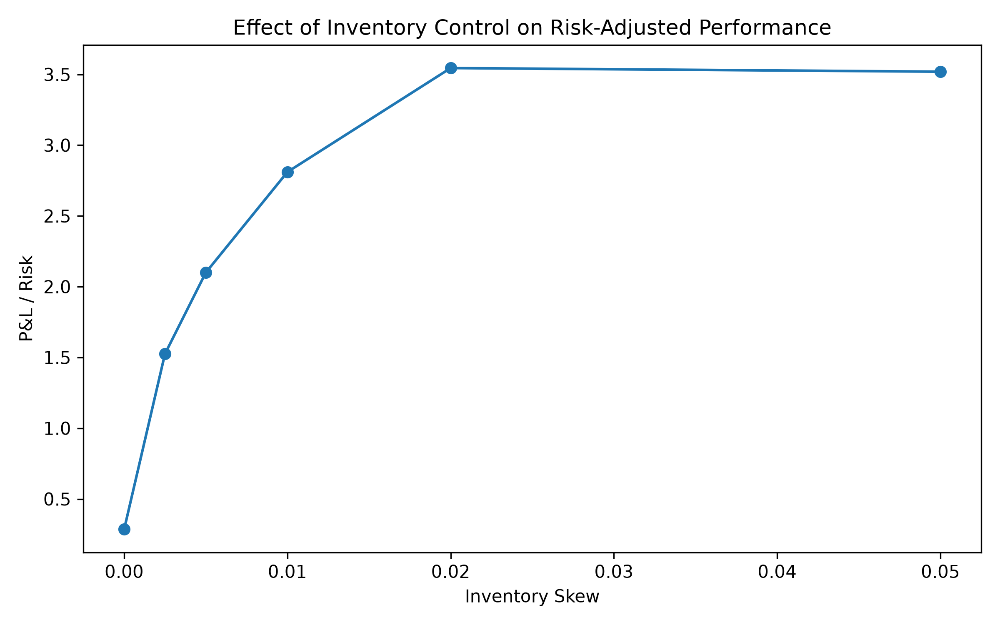
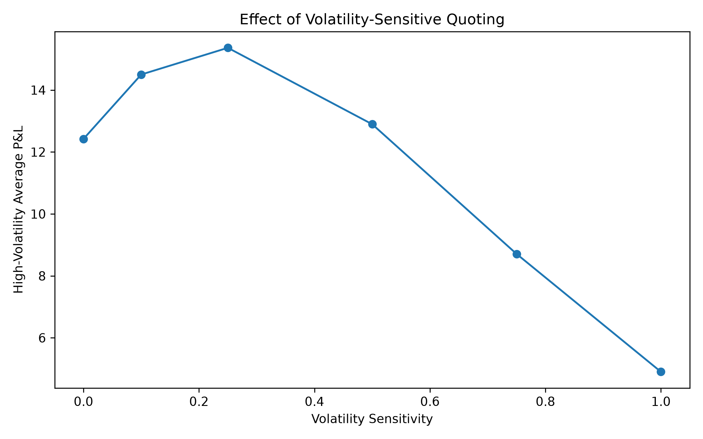
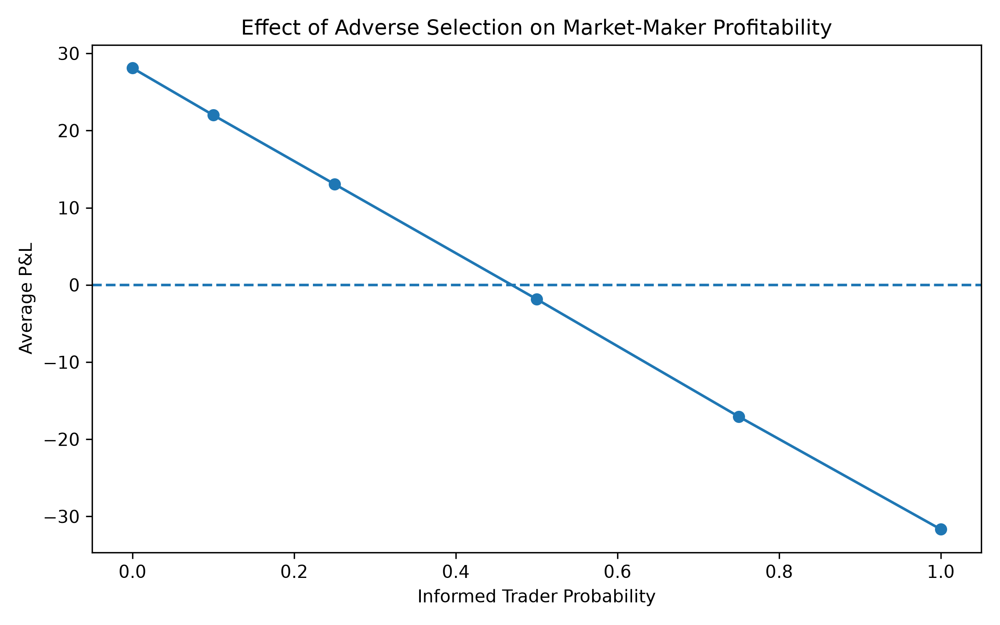
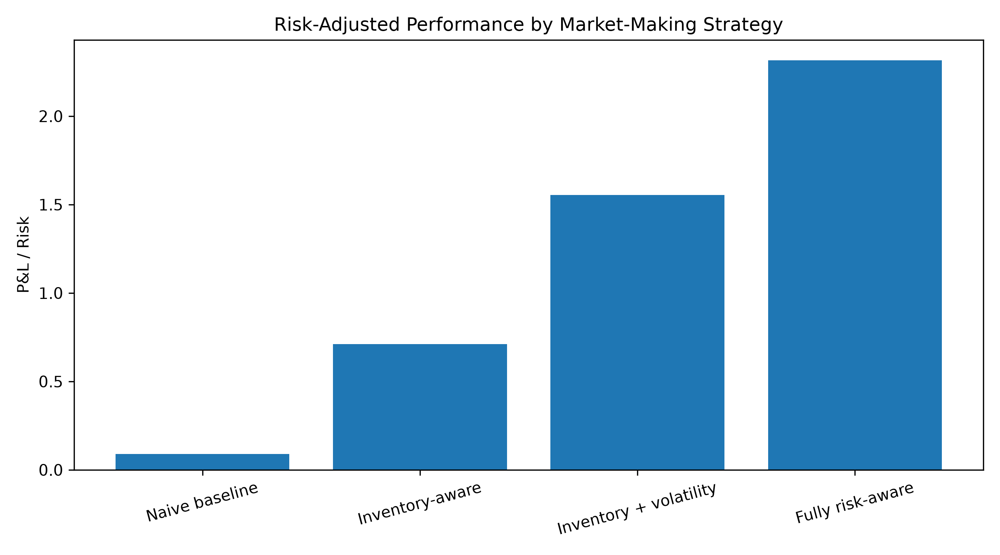

# Market Making Simulator

A Python-based Monte Carlo simulator for studying market-making strategies, inventory risk, volatility-sensitive quoting, adverse selection, and transaction costs.

The project explores a central market-making problem:

> **How should a market maker adjust its quotes to balance spread capture against inventory, volatility, and information risk?**

Rather than optimizing a single strategy from the start, the simulator builds from a naive fixed-spread market maker to increasingly risk-aware quoting strategies and compares their performance across controlled experiments.

## Overview

At each timestep, the simulator models:

1. A market maker posting a bid and ask around an estimated fair price
2. A trader arriving with a private valuation
3. A possible trade depending on whether the trader crosses the quoted spread
4. A stochastic movement in the asset's fair price
5. Changes in cash, inventory, and marked-to-market P&L

The simulator supports:

- Fixed and inventory-adjusted quotes
- Low- and high-volatility market regimes
- Volatility-sensitive spread widening
- Informed and uninformed traders
- Adverse-selection analysis using trade markouts
- Per-trade transaction costs
- Monte Carlo strategy evaluation

## Market Model

The asset's fair price evolves according to

$$
S_{t+1}=S_t+\sigma_t Z_t,
\qquad
Z_t\sim N(0,1),
$$

where $\sigma_t$ depends on the current volatility regime.

The default simulation uses:

- Low volatility: $\sigma_{\text{low}}=0.05$
- High volatility: $\sigma_{\text{high}}=0.20$

The first half of the simulation uses the low-volatility regime and the second half uses the high-volatility regime.

### Inventory-Aware Quoting

The market maker adjusts its reservation price based on inventory:

$$
r_t=S_t-\alpha q_t,
$$

where:

- $S_t$ is the current fair price
- $q_t$ is the market maker's inventory
- $\alpha$ controls inventory sensitivity

A positive inventory shifts both quotes downward, encouraging traders to buy inventory from the market maker. A negative inventory shifts quotes upward.

### Volatility-Sensitive Spreads

The half-spread is adjusted according to market volatility:

$$
\delta_t = \delta_0+\beta(\sigma_t-\sigma_{\text{low}}),
$$

where:

- $\delta_0$ is the base half-spread
- $\beta$ controls volatility sensitivity

The resulting quotes are

$$
Bid_t=r_t-\delta_t,
$$

$$
Ask_t=r_t+\delta_t.
$$

This allows the market maker to demand greater compensation for trading during volatile market conditions.

## Adverse Selection

The simulator also includes informed traders.

Uninformed traders have valuations of the form

$$
V_t=S_t+\epsilon_t.
$$

Informed traders receive information about the upcoming price movement:

$$
V_t = S_t+\lambda\Delta S_{t+1}+\epsilon_t,
$$

where $\lambda$ determines the strength of their information.

This creates adverse selection: informed traders are more likely to trade when the market maker's quote is about to become stale.

To measure this directly, the simulator calculates one-step trade **markouts**. Negative markouts indicate that the fair value moved against the market maker immediately after execution.

## Experiments

All reported results use Monte Carlo simulation across 1,000 independent trials.

### 1. Inventory Risk

The first experiment varies the inventory-skew parameter $\alpha$.

Without inventory control, the market maker can accumulate large directional positions. Introducing inventory-aware quoting sharply reduces inventory exposure and P&L variability.

<p align="center">
  
</p>

Moderate inventory sensitivity substantially improves risk-adjusted performance, while increasingly aggressive inventory control eventually produces diminishing returns.

### 2. Volatility-Sensitive Quoting

The second experiment varies the volatility-sensitivity parameter $\beta$.

<p align="center">
  
</p>

Moderately widening spreads during high-volatility periods improves high-volatility P&L. Excessive spread widening reduces execution volume enough to hurt profitability.

Among the tested parameters, performance peaked near $\beta=0.25.$

### 3. Adverse Selection

The third experiment increases the fraction of informed traders.

<p align="center">
  
</p>

Market-maker profitability falls steadily as order flow becomes more informed and turns negative when approximately half of arriving traders are informed.

Informed trades also produce systematically negative markouts, while uninformed trades generally produce positive markouts.

This demonstrates that greater trading volume is not necessarily beneficial if the additional order flow is toxic.

### 4. Final Strategy Comparison

Four strategies were evaluated under the same simulated market conditions:

| Strategy | Avg P&L | P&L Std | P&L / Risk | Avg Trades | Avg Max \|Inventory\| |
|---|---:|---:|---:|---:|---:|
| Naive baseline | 8.69 | 97.44 | 0.09 | 647.9 | 30.85 |
| Inventory-aware | 5.70 | 8.00 | 0.71 | 662.6 | 5.29 |
| Inventory + volatility | 11.66 | 7.50 | 1.55 | 559.8 | 4.97 |
| Fully risk-aware | **16.21** | **7.00** | **2.32** | **312.3** | **4.33** |

<p align="center">
  
</p>

Relative to the naive baseline, the fully risk-aware strategy achieved approximately:

- **86% higher average P&L**
- **93% lower P&L standard deviation**
- **86% lower peak inventory exposure**
- **26× higher P&L-to-risk ratio**

The final strategy also executed roughly half as many trades, demonstrating that execution quality can matter substantially more than raw trading volume.

## Risk Metric

For Monte Carlo comparisons, the project uses

$$
\text{P\&L-to-risk} = \frac{E[\text{terminal P\&L}]}
{\operatorname{Std}(\text{terminal P\&L})}.
$$

This is used as a simple signal-to-risk measure across simulated outcomes.

It is **not** intended to represent a Sharpe ratio, since the calculation uses terminal P&L across Monte Carlo trials rather than a time series of investment returns.

## Transaction Costs

A configurable per-trade transaction cost is deducted from cash after every execution.

As expected,

$$
E[\text{net P\&L}] \approx E[\text{gross P\&L}] - cE[N_{\text{trades}}],
$$

where $c$ is the cost per trade.

This demonstrates how high-turnover strategies can lose a meaningful portion of their apparent edge once trading frictions are included.

## Repository Structure

```text
market-making-simulator/
├── src/
│   ├── __init__.py
│   ├── simulator.py
│   ├── strategies.py
│   └── metrics.py
├── experiments/
│   ├── inventory_analysis.py
│   ├── volatility_analysis.py
│   ├── adverse_selection_analysis.py
│   └── final_comparison.py
├── tests/
│   ├── test_simulator.py
│   └── test_strategies.py
├── results/
│   └── figures/
├── README.md
├── requirements.txt
└── .gitignore
```

## Running the Project

Create and activate a virtual environment:

```bash
python3 -m venv .venv
source .venv/bin/activate
```

Install dependencies:

```bash
pip install -r requirements.txt
```

Run the final strategy comparison:

```bash
python3 -m experiments.final_comparison
```

Run individual experiments:

```bash
python3 -m experiments.inventory_analysis
python3 -m experiments.volatility_analysis
python3 -m experiments.adverse_selection_analysis
```

Run the test suite:

```bash
python3 -m pytest -v
```

The current test suite verifies core quoting logic, inventory updates, P&L accounting, markout calculations, volatility-sensitive spreads, and reproducibility under fixed random seeds.

## Key Takeaways

The experiments highlight several fundamental market-making concepts:

- **Inventory management matters.** Symmetric quoting can generate large unintended directional exposure.
- **Market conditions should affect spreads.** Moderate spread widening can improve performance when volatility rises.
- **Not all order flow is equally valuable.** Informed traders systematically generate worse fills for the market maker.
- **Wider spreads can compensate for adverse selection, but only up to a point.**
- **More trades do not necessarily mean more profit.** The final strategy traded substantially less than the baseline while generating higher average P&L.
- **Transaction costs matter.** Trading frequency must be considered alongside gross profitability.

## Limitations

This is a simplified research simulator rather than a production trading system.

Important assumptions include:

- The market maker observes the current fair value directly.
- Price changes follow a stylized Gaussian process.
- The simulator contains one asset and one market maker.
- Orders have fixed unit size.
- There is no explicit limit-order book or queue priority.
- Execution and latency are simplified.
- Volatility regimes are predetermined rather than estimated from market data.
- Informed traders receive a stylized signal about the next price movement.

These simplifications make it possible to isolate individual market-making mechanisms and study them in a controlled environment.

## Future Work

Possible extensions include:

- Estimating volatility dynamically from recent returns
- Random or Markov-switching volatility regimes
- Variable order sizes
- Limit-order-book simulation
- Queue position and partial fills
- Latency
- Competing market makers
- Data-driven calibration using real market data
- More sophisticated optimal-control quoting strategies